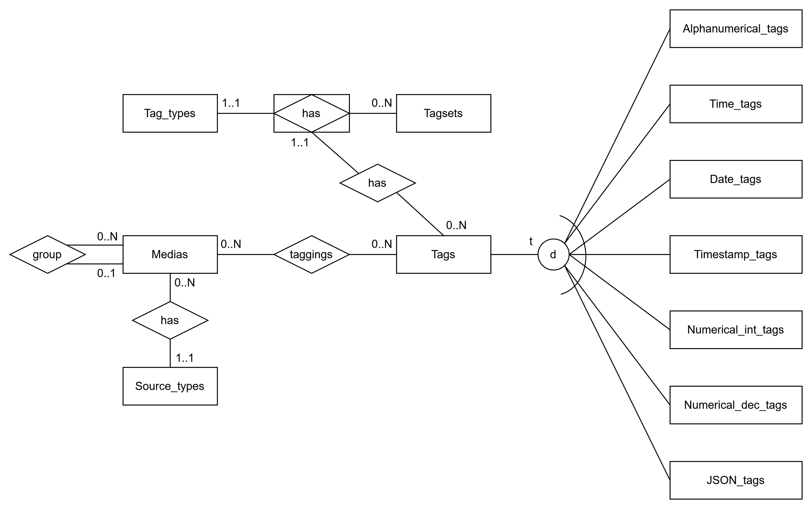

# The M3 model

A media is a record that represents a single media entity (image, video, audio, text, or other). It includes a source field that acts as an identifier or reference, and a source_type that defines what kind of media it is. The group_id field allows media objects to be related to each other, for example linking a video to its keyframes.

Metadata is organized in three layers:

* A tagset is a metadata category (for example, "Day", "Objects", "Categories", "Title").
* A tag is a specific value within that category (for example, "Monday" under "Day", or "Car" under "Objects").
* A tagtype defines the data format of the tag value (text, integer, decimal, date, timestamp, time, or JSON).

The full schema is defined in [m3db/ddl_duckdb.sql](../m3db/ddl_duckdb.sql) for DuckDB and [m3db/ddl.sql](../m3db/ddl.sql) for SQLite.

## Examples of multimedia objects and their metadata

### Video

```id="videx"
Source: "s3://videos/traffic.mp4"
Source Type: Video
  ├── Title (alphanumerical): "Downtown Traffic Scene"
  ├── Category (alphanumerical): "Urban"
  ├── Upload Date (date): 2026-02-10
  ├── Duration (ms) (integer): 60000
  ├── Objects (alphanumerical): ["car", "person"]
```

---

### Keyframe

```id="kfex"
Source: "s3://videos/traffic_frame_12000.jpg"
Source Type: Image
Group: "s3://videos/traffic.mp4"
  ├── CLIP Index ID (integer): 42
  ├── Start (ms) (integer): 10000
  ├── End (ms) (integer): 15000
  ├── Keyframe (ms) (integer): 12000
  ├── Objects (alphanumerical): ["car"]
```

---

### Transcript

```id="trex"
Source: "s3://videos/traffic_transcript_10000.txt"
Source Type: Text
Group: "s3://videos/traffic.mp4"
  ├── Transcript Index ID (integer): 7
  ├── Start (ms) (integer): 10000
  ├── End (ms) (integer): 15000
  ├── Transcript (alphanumerical): "The light turns green and the cars move on"
```

This example shows a 1 minute video, one keyframe and one transcript segment from it. The keyframe is the frame at 12000 ms (12 seconds), chosen to represent the shot from 10000 ms to 15000 ms (10 - 15 seconds) of the video. The transcript holds the speech of the same shot. The group of both is the video's source.

CLIP Index ID is the row of the keyframe's CLIP embedding in an image search index, and Transcript Index ID is the row of the transcript's text embedding in a separate text search index. Each index numbers its own rows, so each has its own tagset.

In the database (M<sup>3</sup> model) these three media objects will be represented in the following way:

* 3 media rows
  - One row for the video (source type: Video)
  - One row for the keyframe image (source type: Image)
  - One row for the transcript (source type: Text)
  - The keyframe and transcript rows reference the video through group_id

* Multiple tagsets (metadata categories)
  - "CLIP Index ID", "Transcript Index ID", "Duration (ms)", "Start (ms)", "End (ms)", "Keyframe (ms)" as tagsets with type `numerical_int`
  - "Title", "Category", "Objects", "Transcript" as tagsets with type `alphanumerical`
  - "Upload Date" as tagset with type `date`

* Tags / actual values of the tagsets will be added to their respective typed tag table

* Tags are then linked with medias through their ids (media_id, tag_id)

## ER diagram and tables



The diagram shows these relationships.

* **source_types to medias, one to many.** Each media has one source type (`medias.source_type` → `source_types.id`), and a source type can have many medias.
* **medias to medias, one to many.** A media may belong to one group, named by `medias.group_id` → `medias.id`. A group's media can have many members, for example a video and its keyframes.
* **tag_types to tagsets, one to many.** Each tagset has one tag type (`tagsets.tagtype_id` → `tag_types.id`), and a tag type can have many tagsets.
* **tagsets to tags, one to many.** Each tag belongs to one tagset, through the pair (`tags.tagset_id`, `tags.tagtype_id`) → (`tagsets.id`, `tagsets.tagtype_id`). So a tag always has the tag type of its tagset.
* **tags to tag values, one to one.** Each tag has exactly one value row, in the table of its tag type, such as `alphanumerical_tags` or `date_tags`, with the same id (`<type>_tags.id` → `tags.id`). The value row also names its tagset (`<type>_tags.tagset_id` → `tagsets.id`), and a value appears at most once per tagset.
* **medias to tags, many to many.** The table `taggings` links them with one row per pair (`taggings.media_id` → `medias.id`, `taggings.tag_id` → `tags.id`). A media can have many tags, and a tag can be on many medias.

The simplified version of the multi-dimensional database consists of the following schema.

* Tagtype: (ID, description)
  - Different column types for tags
  - Default types: alphanumerical, timestamp, time, date, numerical_int, numerical_dec, json
  - DuckDB stores each type natively. SQLite stores dates, times and timestamps as text, and numerical_dec values as floating point numbers.

* Tagsets: (ID, name, tagtype_id)
  - A tagset is a metadata category
  - For instance: "Day", "Objects", "Categories", and "CLIP Index ID"

* Tags: (ID, tagset_id, tagtype_id)
  - A tag represents a value of the tagset (metadata category).
  - Each tagtype has a representative table, such as alphanumerical_tags (ID, value, tagset_id), where ID is the same as in the tag table.

* Medias: (ID, source, source_type, thumbnail_uri, group_id)
  - A media represents the multimedia data item / object. In the original M3 definition this schema element was referred to as Objects.
  - source_type refers to the ID of a source_type table with the types being: Image, Video, Audio, Text, and Other.
  - The source is the URI to the media, and the thumbnail_uri is an optional field to add an image representation of the media.
  - Group_id refers to another media objects id, making it possible to have one media related to many others, for instance a video media object having many keyframe image media objects.

* Source types: (ID, name)
  - The type of the media
  - Default values (Image, Video, Audio, Text, Other)
